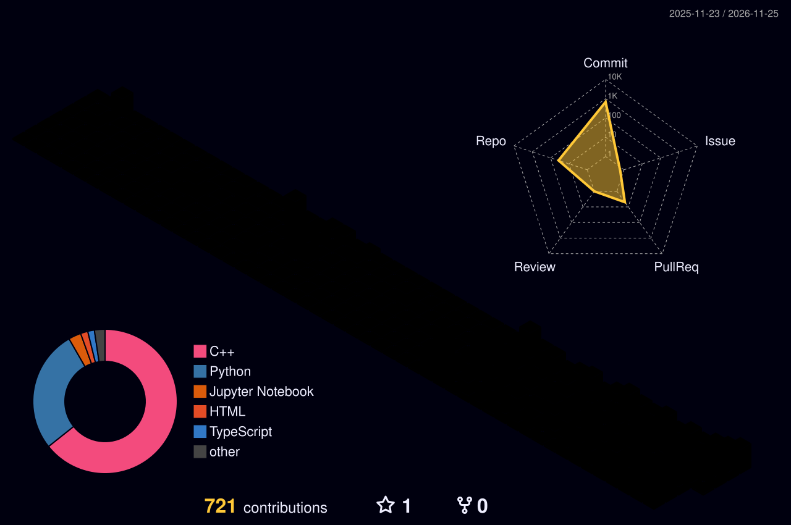

# VANSH KUMAR

### AI/ML Engineer · AI Systems Builder · Research-Oriented Developer

*Building systems. Running experiments. Learning from evidence.*

---

## `01` / ABOUT

- 🎓 Computer Science undergraduate — JSS Academy of Technical Education, Noida
- 🧠 Focus: LLMs, agentic systems, machine learning, deep learning and AI research
- ⚙️ Building: local coding agents, financial intelligence systems and ML pipelines
- 🔬 Interested in model evaluation, agent reliability, inference efficiency and quantitative research
- 💻 250+ LeetCode problems solved
- 🏆 SIH 2025 Winner · Hacknovate 7.0 Runner-up · Amazon ML Summer School selected

> I want to understand what happens beneath the abstraction — then build, test and measure it.

---

## `02` / FEATURED WORK

<table>
<tr>
<td width="50%" valign="top">

### ⚙️ [AgentFlow](https://github.com/Vanshkumar16/Agentfllow)

**Budget-aware recovery for local software engineering agents.**

- Compares single-shot, fixed-retry and failure-guided recovery
- Local model execution with Ollama
- Workspace boundaries and explicit execution budgets
- Frozen held-out evaluation: 15 tasks × 3 strategies

`Python` `Ollama` `Gemma` `Agent Evaluation`

</td>
<td width="50%" valign="top">

### 📈 [APEX](https://github.com/Vanshkumar16/Apex)

**Bloomberg-style financial workstation.**

- Market data and real-time WebSocket feeds
- Terminal commands, charts, news and portfolio views
- AI market copilot with market context
- FastAPI backend and persistent storage

`Python` `FastAPI` `WebSockets` `JavaScript`

</td>
</tr>
<tr>
<td width="50%" valign="top">

### 💡 [FINORA](https://github.com/Vanshkumar16/finora)

**AI-powered financial operating system.**

- Financial dashboards and transaction intelligence
- AI financial assistant and document intelligence
- Anomaly alerts and stock terminal
- Product direction informing APEX

`Next.js` `TypeScript` `Node.js` `PostgreSQL`

</td>
<td width="50%" valign="top">

### 🛡️ [Network Intrusion Detection](https://github.com/Vanshkumar16/Intrusion-System)

**Botnet traffic classification using CICIDS2017.**

- Data cleaning and imbalance handling
- Logistic Regression, Random Forest, XGBoost and LightGBM
- Model evaluation and Streamlit inference interface

`Python` `LightGBM` `XGBoost` `SMOTE`

</td>
</tr>
<tr>
<td width="50%" valign="top">

### 🏎️ [F1 Stacking Ensemble](https://github.com/Vanshkumar16/f1-stacking-ml)

**Time-aware race result prediction.**

- Year-based cross-validation
- Feature engineering and OOF predictions
- Optuna tuning and weighted ensembling

`Python` `LightGBM` `XGBoost` `Optuna`

</td>
<td width="50%" valign="top">

### 🧠 [Transformer Implementation](https://github.com/Vanshkumar16/attention_isall_you_need)

**Implementation-focused study of the Transformer architecture.**

- Attention and encoder/decoder blocks
- Positional encoding and feed-forward layers
- Training and evaluation pipeline

`Python` `PyTorch` `Deep Learning`

</td>
</tr>
</table>

**More work:** [Deep-ML Practice](https://github.com/Vanshkumar16/deep-ml) · [Supply Chain RL Environment](https://github.com/Vanshkumar16/supply_chain_envi) · [All repositories](https://github.com/Vanshkumar16?tab=repositories)

---

## `03` / CONNECT

---

## `04` / SKILLS & LANGUAGES

## AI / MACHINE LEARNING

## BACKEND / DATA / TOOLS

---

## `05` / GITHUB ACTIVITY

### Contribution calendar

### Contribution streak

### GitHub statistics & coding activity

---

## `06` / 3D CONTRIBUTION GRAPH

<!--
To enable the animated 3D contribution skyline:
1. Add the github-profile-3d-contrib workflow to this profile repository.
2. Enable GitHub Actions and grant the workflow permission to write repository contents.
3. The workflow generates profile-3d-contrib/profile-night-rainbow.svg.
-->

  

---

**Understand deeply. Build carefully. Measure honestly. Improve continuously.**

